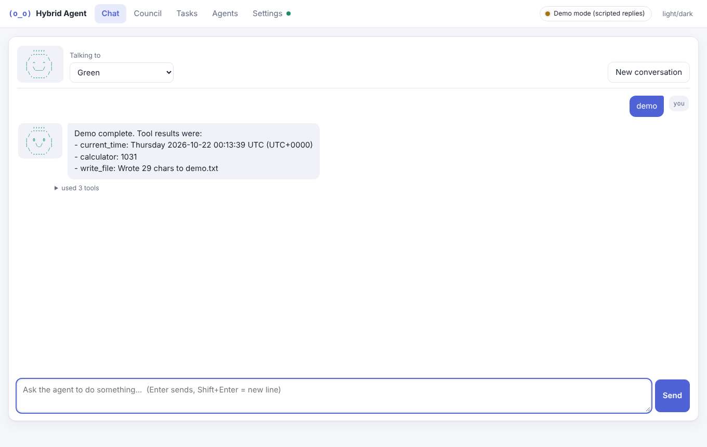
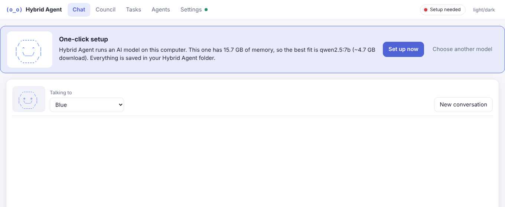
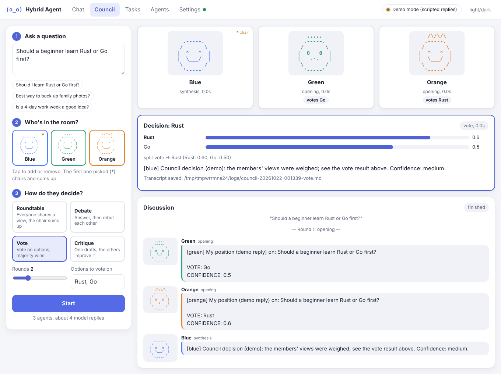
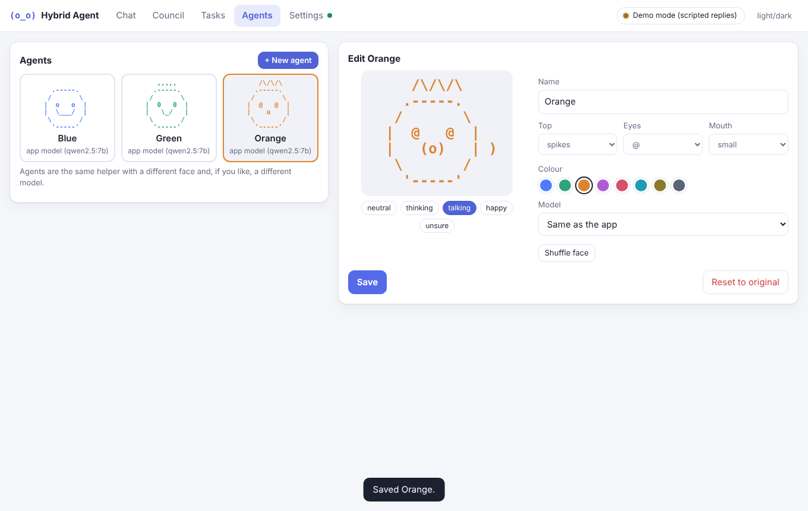
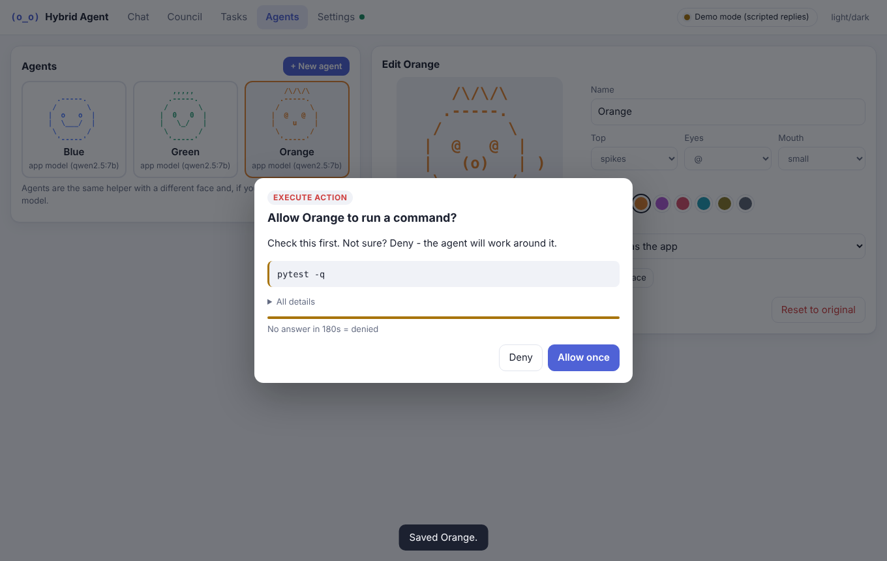
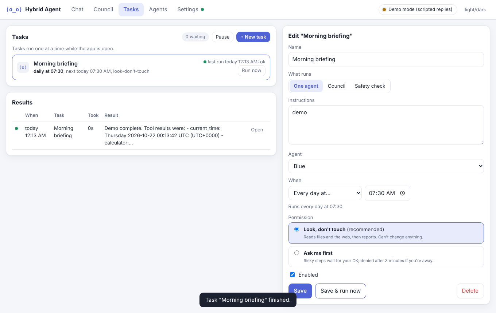
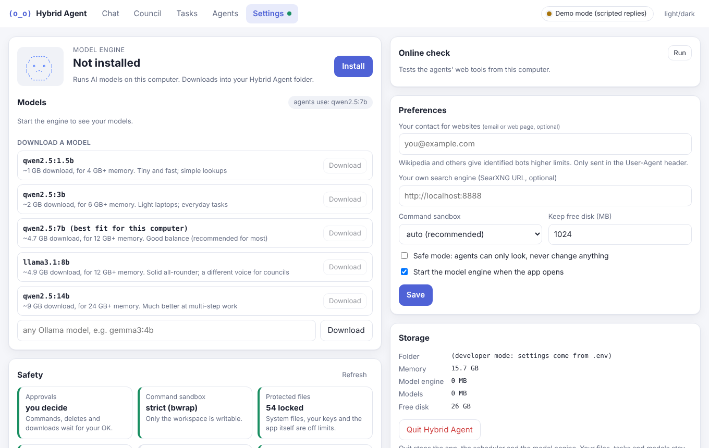
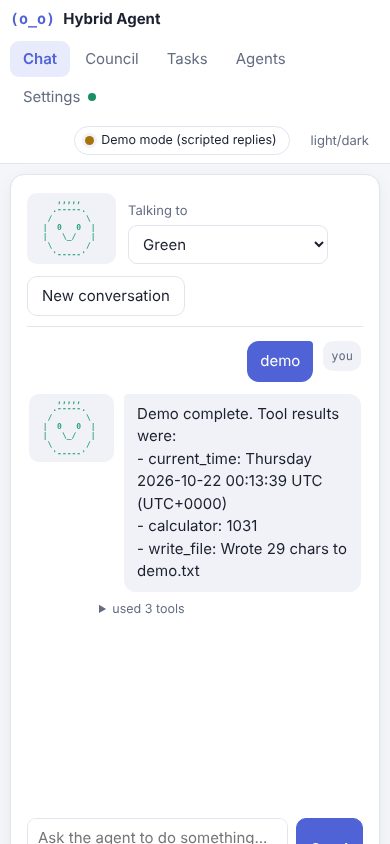

# Hybrid Agent

Your own AI helpers, running on your own Windows PC. No account, no API key, no monthly bill.

```
                       ,,,,,             /\/\/\
    .-----.           .-----.           .-----.
   /       \         /       \         /       \
  |  o   o  |       |  0   0  |       |  @   @  |
  |  \___/  |       |   \_/   |       |    u    |
   \       /         \       /         \       /
    '-----'           '-----'           '-----'
      Blue             Green             Orange
```



## Get started

1. **Download** `HybridAgent-1.2.0-windows-x64.zip` from the
   [latest release](https://github.com/binigooh-dot/hybrid-agent/releases/latest) and unzip it anywhere.
2. **Double-click `HybridAgent.exe`.** The app opens in its own window. Keep the small black window open;
   closing it stops the app.
3. **Press "Set up now".** It downloads the AI engine and a model sized for your PC's memory
   (a one-time 1-9 GB download).



Windows may say "Windows protected your PC" the first time, because the app isn't code-signed:
click **More info**, then **Run anyway**.

## What you can do

| Tab | For |
|---|---|
| **Chat** | Ask an agent to look things up (Wikipedia, the web, weather), work with files, do maths, write code |
| **Council** | Ask a question; several agents answer on their own, debate or vote, and the chair sums up |
| **Tasks** | Schedule work, e.g. "every weekday at 7:30, summarise the news". Results are saved for you |
| **Agents** | Make your own agents: pick a face (plain text) and, if you like, a different model |
| **Settings** | Models, safety status, undo history, an online check and preferences |

<details><summary>More screenshots</summary>








</details>

How it fits together:

```
 you --> Chat / Council / Tasks --> agent --> tools (files, web, maths, code...)
                                      |          \--> risky? asks you first
                                      v
                 AI model on your PC (free)   or   Claude (optional, needs a key)
```

## Safe by default

Think of the agents as interns with their own desk. They can rearrange anything on the desk, they must ask
before using the phone or the shredder, and whatever they throw away lands in a bin you can pull it back from.

- Agents can only change files in `home\workspace`.
- Running a command, deleting or downloading waits for your OK. No answer in 3 minutes means no.
- Every file they change or delete is backed up first: **Settings > Undo history > Restore**.
- Scheduled tasks can only look, not change anything, unless you choose otherwise.
- The app only accepts connections from your own computer.

The details fit on one page: [docs/SAFETY.md](docs/SAFETY.md).

## Your files

Everything lives in the folder you unzipped. Move or back it up and nothing is lost; delete it to uninstall.

```
HybridAgent\
  HybridAgent.exe      start here
  home\                created on first run
    workspace\         the agents' files
    agents\ tasks\     your agents, schedules and results
    models\ runtime\   the AI engine and models
    settings.env       your settings (the Settings tab edits these)
```

## Optional extras

- **Claude:** add `ANTHROPIC_API_KEY=sk-ant-...` to `home\settings.env`. Agents then use Claude and fall back
  to the local model.
- **Command line:** `HybridAgent.exe chat`, `council`, `doctor` (checks your setup), `diagnose` (safety drills).
- **Run from source** on any OS with Python 3.10+: [docs/DEVELOPING.md](docs/DEVELOPING.md).

What changed: [CHANGELOG.md](CHANGELOG.md).
