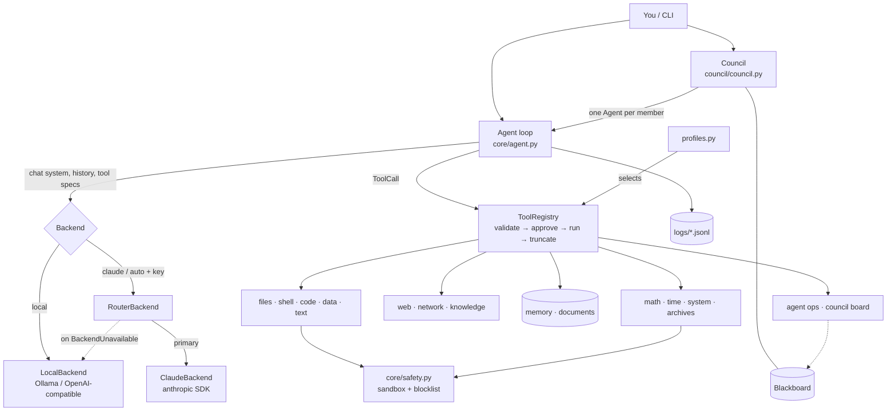
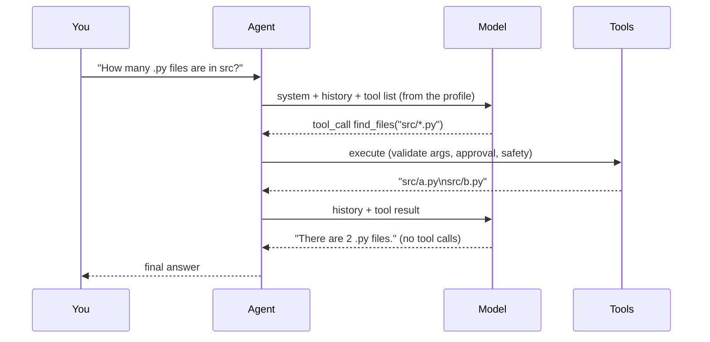

# 03 · Architecture

## Layers

Analogy: a building. Each floor uses only the floors below it.

```
 ┌────────────────────────────────────────────────────────────────────┐
 │ CLI          cli/main.py · cli/doctor.py                           │  you
 ├────────────────────────────────────────────────────────────────────┤
 │ COUNCIL      council/ - members, roles, protocols, ballots, board  │  many agents
 ├────────────────────────────────────────────────────────────────────┤
 │ CORE         core/agent.py - the think → act → observe loop        │  one agent
 ├───────────────────────────────┬────────────────────────────────────┤
 │ BACKENDS (the brain)          │ TOOLS (the hands)                  │
 │ local · claude · router ·     │ registry · profiles ·              │
 │ scripted/canned               │ builtin/ (15 modules, 78 tools)    │
 ├───────────────────────────────┴────────────────────────────────────┤
 │ CORE basics   messages · config · safety · errors                  │  shared vocabulary
 └────────────────────────────────────────────────────────────────────┘
```



## One agent turn



The loop stops when the model replies **without** tool calls, or after `max_steps`. Two safeguards:
- **Truncation guard:** if the model hit its output limit, its tool calls may have cut-off arguments.
  They are *not* run; each gets an error result telling the model to retry with smaller input.
- **Rollback:** if the backend fails partway through `run()`, the history is restored to how it was
  before, so a retry never sees orphaned messages.

## Design decisions

| Decision | Why |
|---|---|
| **Neutral message format** (`core/messages.py`), with a converter in each backend | One loop, one tool set, any model. Like a universal power adapter: the device stays the same. |
| **Manual loop rather than the Anthropic SDK's tool runner** | The tool runner only drives Claude. The local model needs the same loop. |
| **Original Claude content blocks are kept (`Message.raw`)** | The Claude API requires thinking blocks to be sent back unchanged. |
| **Parallel tool results merged into one user message** for Claude | Required by the API. Splitting them teaches Claude to stop making parallel calls. |
| **Errors become `BackendUnavailable`** (network, 401, 429, 5xx) | One clear signal for "try the other model". 400 errors are *not* converted, because they mean a bug in our request. |
| **Server-side refusal fallback on by default** (`CLAUDE_FALLBACKS`) | Recommended for current Claude models. |
| **Effort `medium`** for `claude-opus-5-5` | That model's API default. Raise `CLAUDE_EFFORT` for hard agentic work. |
| **Prompt-mode tool calling** for local models | Works with models that have no native tool calling. |
| **Tool categories + risk labels** | Profiles and council roles can say "research tools, nothing that writes" without listing names by hand. |
| **Curated profiles (7–23 tools)** | The full list is about 6k tokens, which would fill a local model's context and confuse it with choice. |
| **Schema builder `S()` + signature check test** | The model can never be told about an argument the function doesn't accept. |
| **Generated docs** (`scripts/gen_*.py` + a freshness test) | The tool reference and file map can't drift from the code. |
| **Standard library only** for everything local | Nothing to install for key-free mode. |
| **Tool list sorted by name** | The request prefix is byte-identical each turn, which helps Claude's prompt cache. |
| **Tools return error text and never raise** | The model sees the error and corrects itself; the agent never crashes from a tool bug. |
| **`FILE_LOCK` + atomic writes** for memory/index files | Parallel council members can't corrupt shared files. |
| **Council members are ordinary `Agent`s** | Everything a single agent can do, a member can do; the council only adds orchestration. |

## Where the state lives

| State | Location | Lifetime |
|---|---|---|
| Conversation | `Agent.messages` (in RAM) | Until `/reset` or exit (councils reset per deliberation) |
| Plan / thoughts | `ToolContext.state` | Until exit |
| Long-term memory | `<workspace>/.agent/memory.json` | Permanent; shared by all agents and members |
| Document index | `<workspace>/.agent/doc_index.json` | Until rebuilt |
| Council board | `Council.board` (in RAM) + saved in the transcript | One deliberation |
| Files the agent creates | `<workspace>/` | Permanent |
| Transcripts | `logs/*.jsonl`, `logs/council-*.md/.json` | Permanent |

## Extending

- **New tool:** see [04_TOOLS.md](04_TOOLS.md#adding-a-tool).
- **New tool profile:** add it to `PROFILES` in `tools/profiles.py`.
- **New model provider:** subclass `Backend` (`backends/base.py`) and implement
  `chat(system, messages, tools) -> LLMResponse`. Raise `BackendUnavailable` for "can't serve
  right now". Add it to `build_backend` / `build_backend_from_spec` in `backends/__init__.py`.
- **New council role or protocol:** `council/roles.py` and `council/protocols.py`; see [05_COUNCIL.md](05_COUNCIL.md).
- **Hooks / UI:** `Agent(..., on_event=fn)` receives `model`, `thought`, `tool_call`, `tool_result`
  and `message` events. `Council(..., on_event=fn)` also receives `council` events
  (`round_start`, `member_done`, `consensus`…).
