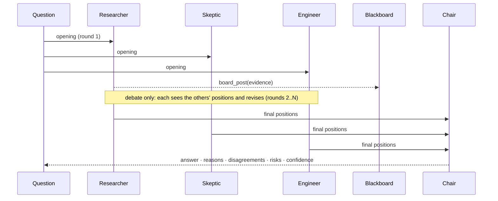

# 05 · Council of agents

A **council** is several agents deliberating on one question. Each member has its own
role, its own model (Claude, or one of several local models) and its own tool profile.
A chair then turns their views into one answer.

**Analogy: a board meeting.**

| Meeting | Council |
|---|---|
| Board members with different expertise | `MemberSpec` with a `role` (researcher, skeptic, engineer…) |
| Each member's private notepad | Each member's own `Agent` conversation history |
| The whiteboard on the wall | `Blackboard` (`board_post` / `board_read` tools) |
| Rules of order (brainstorm, debate, motion and vote) | `protocols.py`: roundtable, debate, vote, critique |
| The chair | The member who synthesises the final answer |
| The minutes | `CouncilResult.save()`, a Markdown + JSON transcript |

## Why a council helps

One model has one set of blind spots. A council gets more diverse answers from three settings:

1. **Role/persona**: what each member cares about (a skeptic hunts for flaws, an advocate for users).
2. **Model**: different local models (qwen, llama, mistral…) and Claude make *different* mistakes.
3. **Tools**: a researcher can search the web; a skeptic is read-only.

Expect better coverage, but it costs more: N members means roughly N× the model calls of a single agent.

## How a deliberation flows



## Protocols

| Protocol | Steps | Model calls (N members, R rounds) | Best for |
|---|---|---|---|
| `roundtable` | Independent answers, then chair synthesis | N + 1 | Brainstorming, broad coverage, cheapest |
| `debate` | Openings, then R−1 rebuttal rounds (stops early on consensus), then synthesis | ≤ N·R + 1 | Hard questions with a defensible answer |
| `vote` | (Chair proposes options if none are given), members vote with reasons and confidence, tally, chair writes it up and breaks ties | N + 1 (+1) | Choosing between options |
| `critique` | Author drafts, others critique, author revises, ×R | 1 + R·(N−1) + R | Producing a plan, document or code |

*"Model calls" counts contributions. Each contribution can include several tool-use steps
(capped by `max_steps`, default 12 for members).*

### Voting

Members end vote-style answers with:
```
VOTE: <option>
CONFIDENCE: <0-1 or %>
```
`tally_mode: "weighted"` (the default) scores each vote as member `weight` × confidence. `"majority"` gives
one member one vote. Invalid or missing votes count as abstentions. A tie is handed to the chair.

## Roles

| Role | Persona in short | Default tools |
|---|---|---|
| `chair` | Weighs contributions, resolves conflicts, writes the final answer | `readonly` |
| `researcher` | Grounds the discussion in facts and sources | `research` |
| `skeptic` | Devil's advocate: flaws, risks, edge cases | `readonly` |
| `engineer` | Practicality, steps, effort, trade-offs; can prototype | `coding` |
| `analyst` | Numbers: estimates, costs, probabilities | `data` |
| `strategist` | Goals, priorities, sequencing, long-term effects | `minimal` |
| `advocate` | The end user's needs, safety and fairness | `minimal` |
| `generalist` | Honest, well-reasoned view | `core` |

Every member also gets the `board_post` / `board_read` tools.
Add a role in `hybrid_agent/council/roles.py`, or give one member a custom `persona`.

## Running one

```bash
# Default council (chair, researcher, skeptic, engineer) on your configured backend:
python -m hybrid_agent council -p "Should our team move from REST to GraphQL?" --protocol debate --rounds 2

# Vote between explicit options:
python -m hybrid_agent council -p "Pick a database for the MVP" --protocol vote --options "PostgreSQL,SQLite,MongoDB"

# Your own members, from a config file:
python -m hybrid_agent council --council-config examples/council.example.json -p "..."

# Dry run of any config with canned replies (no models needed):
python -m hybrid_agent council --backend scripted --council-config examples/council.example.json -p "test"
```

Each session saves `logs/council-<time>-<protocol>.md` (readable minutes) and `.json` (everything).

### Config file

```json
{
  "protocol": "debate", "rounds": 2, "tally_mode": "weighted", "workers": 1, "chair": "chair",
  "members": [
    {"name": "chair",      "role": "chair",      "backend": "claude"},
    {"name": "researcher", "role": "researcher", "backend": "local:qwen2.5:7b"},
    {"name": "skeptic",    "role": "skeptic",    "backend": "local:llama3.1:8b", "tools": "readonly,+web_search"},
    {"name": "engineer",   "role": "engineer",   "backend": "local", "weight": 1.5,
     "persona": "optional: replaces the role's persona text"}
  ]
}
```

| Member field | Meaning |
|---|---|
| `name` | Unique id (required) |
| `role` | One of the roles above (default `generalist`) |
| `backend` | `default` · `local` · `local:<model>` · `claude` · `claude:<model>` · `scripted` |
| `tools` | Profile string; default comes from the role (see [04_TOOLS.md](04_TOOLS.md#profiles-which-tools-each-agent-gets)) |
| `persona` | Replaces the role's persona text |
| `weight` | Vote weight (default 1.0) |
| `max_steps` | Tool-use steps per contribution (default 12) |

### From Python

```python
from hybrid_agent.core.config import Config
from hybrid_agent.council import Council, MemberSpec

council = Council([MemberSpec("chair", "chair"), MemberSpec("analyst", "analyst"),
                   MemberSpec("skeptic", "skeptic", backend="local:llama3.1:8b")],
                  Config.from_env(), workers=2)
result = council.deliberate("…", protocol="vote", options=["A", "B"])
print(result.tally["summary"], result.final_answer)
result.save(Path("logs"))
```
See `examples/council_demo.py`.

## Running with no API key

A council works fully offline. Use `examples/council.local-only.json`, or set every member to `local`.
For real diversity, pull 2–3 different models (`ollama pull llama3.1:8b`, `ollama pull mistral-nemo`)
and give members different `local:<model>` backends.

**Hardware note:** members run one at a time by default (`workers: 1`). A single Ollama server
answers `OLLAMA_NUM_PARALLEL` requests at once and has to fit every model it loads in memory, so
mixing three 7B models needs roughly 3× the RAM of one, or Ollama swaps them in and out (slow).
`workers > 1` helps most with Claude members, or with several model servers.

## Robustness

- A member whose model fails sits that round out (recorded as an `error` in the transcript); the council continues.
- If **no** member answers in a round, `CouncilError` is raised with a hint to run `doctor`.
- If the chair fails, the result contains the members' raw final positions (and the vote tally) instead.
- Positions shown to other members are trimmed to 2,500 characters each, to protect small context windows.
- The memory and document-index files are written under a shared lock, so parallel members can't corrupt them.
- Approval prompts from parallel members are serialised, so two members can't both be waiting at the terminal.

## Groundwork: what's in place and what's next

Built and tested (`tests/test_council.py`, 15 tests): member specs and config, roles, the blackboard,
ballots and tallies, all four protocols, parallel workers, failure handling, transcripts, CLI, and a dry-run mode.

Natural next steps:
- **`ask_council` tool**: let a normal agent convene a council on a hard sub-question (needs a depth guard so members can't recurse).
- **Streaming progress** of member replies, and a live view of the blackboard.
- **Adaptive protocols**: the chair decides whether another debate round is worth its cost.
- **Per-member memory namespaces** and long-running councils that persist between sessions.
- **Evaluation**: run the same question through one agent and through a council, and compare the quality.
