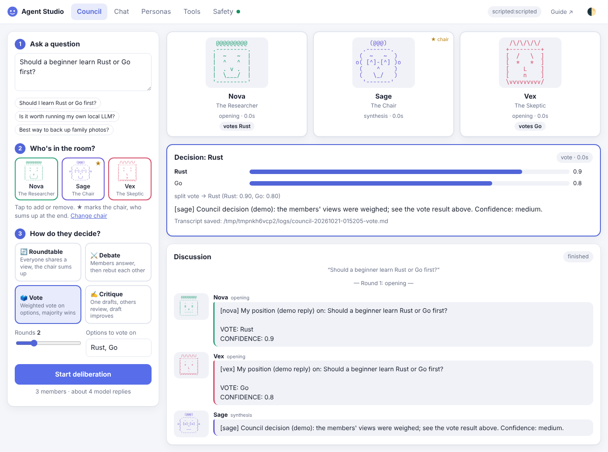
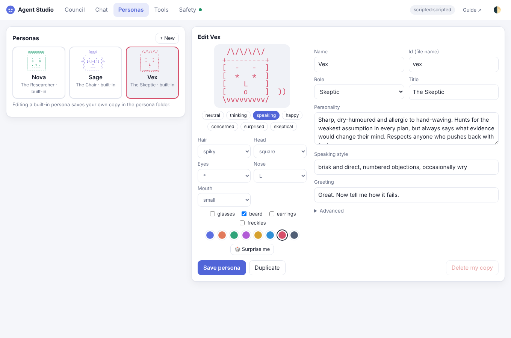
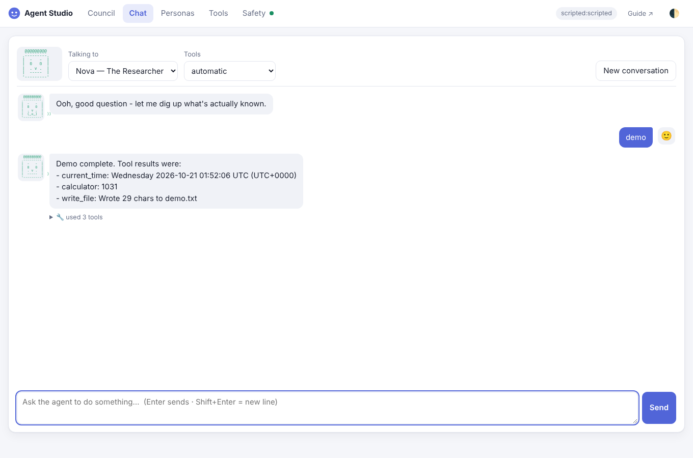
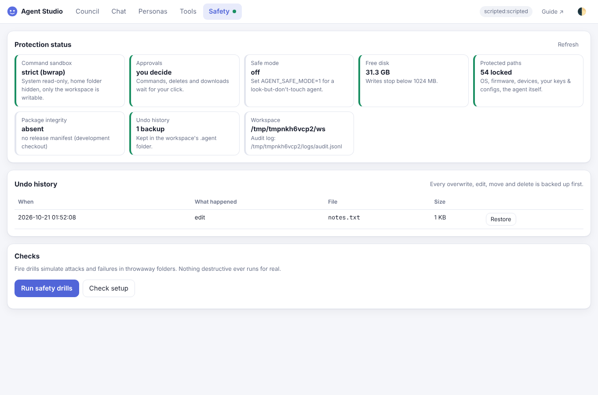

# 06 · GUI (Agent Studio) and personas with faces

## Start it

```bash
python -m hybrid_agent gui                 # opens http://127.0.0.1:8765/?token=...
python -m hybrid_agent gui --port 9000 --no-browser
python -m hybrid_agent gui --backend scripted   # try it with canned replies, no model needed
```

Only this computer can connect, and the link contains a secret token that changes on every launch.
Keep the terminal open; press Ctrl+C to stop.

## What's in it

| Tab | What you can do |
|---|---|
| **Council** | Three numbered steps: ① ask a question (or tap an example), ② tap faces to choose who's in the room (★ marks the chair; "Change chair" rotates it), ③ pick how they decide from four cards (Roundtable, Debate, Vote, Critique). The stage then shows each member's **animated ASCII face**: eyes dart and thought dots grow while they *think*, the mouth moves while they *speak*, and they look *happy* or *concerned* depending on the vote. A conversation-style **Discussion** feed collects every contribution, and the **Decision** card shows the winner, animated vote bars and the chair's answer. |
| **Chat** | Talk to one agent, optionally as a persona (their face and greeting). Tool use is folded into a "🔧 used N tools" line under each reply; open it for the details. Suggestion chips help you get started. |
| **Personas** | A **face builder** with menus (hair, head, eyes, nose, mouth), toggles (glasses, beard, earrings, freckles), colour swatches and a live animated preview for all seven expressions, plus name, role, personality, speaking style and (under *Advanced*) model, vote weight and tool profile. |
| **Tools** | Search and filter all 80 tools by category, risk and profile, with a plain-English risk legend. |
| **Safety** | Status cards (sandbox, approvals, safe mode, free disk, protected paths, package integrity, undo history), an **Undo history** with one-click **Restore**, the safety fire drills and the setup check. A dot on the tab shows the overall state: green = fully protected, amber = no strict sandbox, red = reduced protection. |
| **Guide ↗** | The Agent Builder Knowledge Suite (also at `docs/agent_builder_suite.html`). |

If no local model is reachable, a **first-run banner** explains the three steps to get one (or to try the
demo backend). When an agent wants a risky tool, a dialog shows the risk level, **what exactly will run**
(the command, code, path or URL), and a countdown bar; focus starts on **Deny**, Esc denies, and no answer in
3 minutes means **Deny**. **Stop** in the top bar halts the current job at the next safe point.

| Council | Personas |
|---|---|
|  |  |
| **Chat** | **Safety** |
|  |  |

## How it's built

```
browser  ──fetch + X-Agent-Token──►  gui/server.py  (127.0.0.1 only, stdlib http.server)
   ▲                                     │
   └──── Server-Sent Events ◄── gui/jobs.py EventBus ◄── agents / council (background thread)
                                         │
                              ApprovalBroker ◄── risky tool asks → browser Allow/Deny
```

Analogy: a TV studio control room. The **EventBus** is the live feed to every open tab, the
**ApprovalBroker** is the producer's headset (agents ask, you answer), and the **JobManager** is the
floor manager running one show at a time.

| Protection | Why |
|---|---|
| Listens on `127.0.0.1` only | Unreachable from your network |
| Per-launch random token on every request | Other programs and pages can't use the API |
| `Host` and `Origin` checks | Blocks DNS rebinding and cross-site requests from websites you visit |
| Strict Content-Security-Policy, no inline scripts | Injected script can't run |
| Model output is always rendered as **text** | A model can't inject HTML into the page |
| Only whitelisted static files; 1 MB body cap | No path traversal, no memory abuse |
| Secrets redacted from the live event feed | API keys never reach the browser |

The front end is plain HTML, CSS and JavaScript with no libraries or CDNs (`gui/static/`), so it works offline.
These are tested in `tests/test_gui.py`, and `scripts/ui_smoke.py` drives it in a real headless browser.

## Personas

A persona is a council member with a character. Built-ins: **Sage** (chair), **Vex** (skeptic) and **Nova**
(researcher). Your own go in `./personas/` (see [personas/README.md](../personas/README.md)).

```json
{"id": "atlas", "name": "Atlas", "role": "engineer", "title": "The Builder",
 "personality": "Pragmatic and hands-on.", "speaking_style": "short sentences, concrete steps",
 "greeting": "Show me the constraints.", "backend": "local:llama3.1:8b", "weight": 1.0,
 "face": {"hair": "mohawk", "shape": "square", "eyes": "@", "nose": "L", "mouth": "default",
          "glasses": true, "beard": false, "earrings": false, "freckles": false, "color": "#d6a12f"}}
```

What the model sees: the **role's** persona (what it cares about), then the **character's** personality
and speaking style, with an instruction that style must never get in the way of accuracy.

Use them anywhere:
```bash
python -m hybrid_agent council --personas sage,vex,nova -p "..."
```
```json
{"protocol": "debate", "personas": ["sage", "vex", "nova"]}
```

## Faces

Faces are **ASCII art** (`personas/faces.py`): 7 lines × 16 characters of plain text. No images, no
downloads, no image model; all seven expressions plus the animation frames for one persona come to about
2 KB (the old SVG faces were ~14 KB each).

```
   /\/\/\/\/          hair       spiky curly wavy bun mohawk flat bald
  +---------+         head       oval ( | )  round ( ( ) )  square ( [ ] )
  [  -   -  ]         brows      change with the mood
o [ [*]-[*] ]o        eyes       o 0 @ * Q .   + glasses, earrings
  [  . L .  ]         nose       > < ^ L v J   + freckles
  [   (O)   ]  ))     mouth      default / wide / small; talks in 4 frames
  \vvvvvvvvv/         chin       or beard
```

Analogy: a paper-doll kit. Each persona keeps the same kit; an **expression** only swaps the brows, eyes
and mouth: `neutral`, `thinking`, `speaking`, `happy`, `concerned`, `surprised`, `skeptical`.

| Animation | Frames | What moves |
|---|---|---|
| speaking | 4 | mouth opens and closes, sound marks `))` pulse |
| thinking | 4 | eyes glance left and right, thought dots `. .. ...` grow |
| idle | 1 + blink | eyes close for a moment every few seconds |

The browser runs **one** shared 230 ms timer for every face on screen, and simply swaps the text of a
`<pre>`, so there's no measurable CPU cost. Animation switches off when your system asks for reduced motion.
Every part comes from a fixed menu and faces are written with `textContent`, so a hand-edited persona file
can't inject anything into the page or the terminal. (Older persona files with an `"image"` field still load;
the field is ignored.)

## Groundwork: where to take it next

| Next step | How it plugs in |
|---|---|
| **More face parts** | Add entries to `HAIR`, `EYES`, `NOSES` or a mouth style in `faces.py`; the GUI menus are built from `/api/meta` automatically |
| **Voices (text-to-speech)** | Add `"voice"` to the persona; on `member_done`, send the text to a local TTS (e.g. Piper) and play it. The *speaking* animation already runs while a member talks |
| **Faces in the terminal** | `render_face(face, "speaking", frame)` returns plain text - print it from the CLI with ANSI colour |
| **Per-persona memory** | Prefix memory keys with the persona id, or give each persona its own memory file |
| **Streaming text** | Stream tokens from the local backend and publish them as events, so speech bubbles fill in live |
