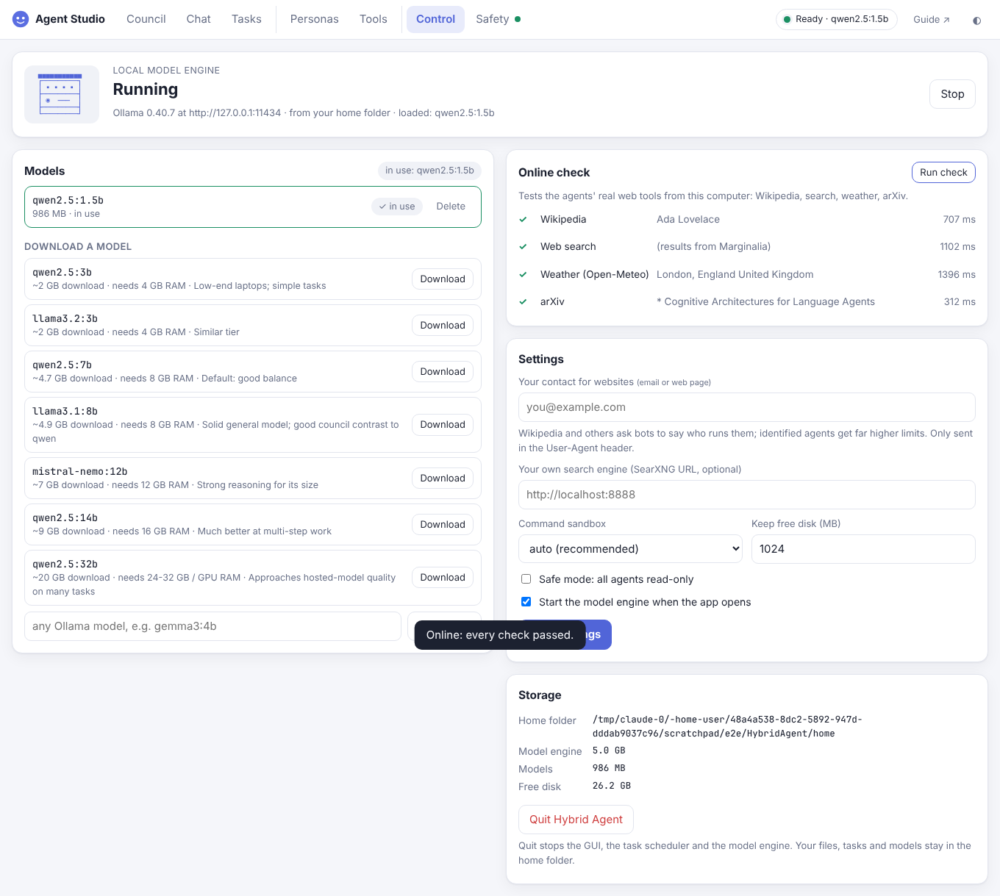
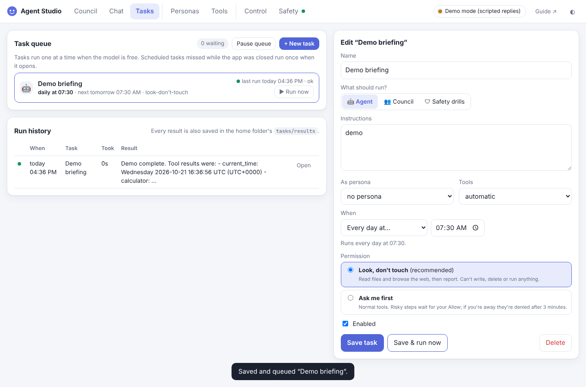

# 08 · The desktop app: HybridAgent.exe, control panel, tasks, going online

One folder, one double-click. The app bundles Python, the agent, the GUI and the task scheduler. It keeps the
local model engine and your models in the same folder, so you can move or back up everything at once.

Analogy: a camper van. The kitchen (model engine), the pantry (models), the logbook (tasks and results) and
your luggage (workspace) all travel together.

## The folder

```
HybridAgent/
├─ HybridAgent.exe      ← double-click: starts everything, opens your browser
├─ _internal/           ← the program (Python + code + GUI), read-only to the agents
├─ MANIFEST.sha256      ← fingerprint of every program file (tamper check)
├─ START HERE.txt
└─ home/                ← created on first run; everything that's yours
   ├─ settings.env      ← your settings (the Control panel edits them)
   ├─ workspace/        ← the only place agents may change files (+ .agent/ undo history)
   ├─ personas/  logs/  ← your characters; transcripts, audit log, engine log
   ├─ tasks/            ← tasks.json, runs.jsonl, results/<task>-<time>.md
   ├─ models/           ← model files (the engine stores them here)
   └─ runtime/          ← the model engine (Ollama), installed from the Control panel
```

Where the home folder lives: `HYBRID_AGENT_HOME` if you set it; otherwise `home/` next to the app.
`hybrid-agent studio` (the pip-installed version) uses `~/HybridAgent/home`.

Protected: `settings.env`, `tasks/`, `runtime/`, `models/`, `HybridAgent.exe` and `_internal/` are on the
protected-path list (docs/07). Agents can't change or delete them, even with a shell command you approve.

## What happens when you double-click

```
HybridAgent.exe
   │ 1 find/create home/, load settings.env
   │ 2 already running?  ──yes──► just reopen the browser tab (no second copy)
   │ 3 start the model engine from home/runtime (background)    [AGENT_AUTO_START_MODEL=1]
   │ 4 start Agent Studio on 127.0.0.1 + the task scheduler
   └ 5 open your browser
Close the console window or press Quit (Control tab): the GUI, the scheduler and the engine it started all stop.
```

| Control (live: engine running, model installed, online check passed) | Tasks |
|---|---|
|  |  |

## Control tab

| Section | What it does |
|---|---|
| **Local model engine** | *Install engine* downloads Ollama from ollama.com into `home/runtime` (Windows ≈1.6 GB; it includes GPU support). *Start/Stop*. If Ollama is already installed on the computer, that one is used instead. The engine listens on 127.0.0.1 only. |
| **Models** | Installed models, sizes, which one is in use (*Use* switches every agent to it). One-click downloads with RAM guidance, or type any Ollama model name. |
| **Online check** | Runs the agents' **real** web tools from this computer (Wikipedia, web search, weather, arXiv) and shows ✓/✕ with timings. |
| **Settings** | Your contact for websites, your own SearXNG search, sandbox mode, keep-free disk, safe mode, auto-start. (Turning the sandbox *off* or approvals *off* is deliberately not possible from the browser.) |
| **Storage** | Home folder, engine and model sizes, free disk, and **Quit**. |

The top bar has one signal that answers "is everything OK?" (research: lead with the answer, details on
demand). **Ready · qwen2.5:7b** (green), **Model engine stopped** (red), or **Demo mode** (amber).
Click it to open the Control tab.

## Tasks: queue and schedule work

```
 you / a schedule ──► queue ──► (model free?) ──► run one task ──► result saved + shown in history
                       ▲                                   │
                       └──── waits while you chat ◄────────┘
```

| Field | Choices |
|---|---|
| What | 🤖 an agent (optionally as a persona, with a tool profile) · 👥 a council (members + protocol) · 🛡 the safety drills |
| When | only when I press Run · once at a date/time · every N minutes · every day at HH:MM · chosen weekdays at HH:MM |
| Permission | **Look, don't touch** (default): read and browse only, so it can't write, delete or run anything. **Ask me first**: normal tools; risky steps wait for your Allow, and are denied after 3 minutes if you're away. |

Behaviour worth knowing:
- One task runs at a time (the model can only think about one thing). A task that comes due while you chat
  waits its turn.
- Missed runs (the app was closed) run **once** when it opens, not once per missed slot.
- A *once* task disables itself after running. *Pause queue* holds everything.
- Every result is a Markdown file in `home/tasks/results/`, and the run history keeps the last 2,000 runs.

Examples:

| Task | What | When | Permission |
|---|---|---|---|
| Morning briefing | "Read Wikipedia's Current events page and summarise the 5 biggest stories" | daily 07:30 | look, don't touch |
| Weekly research digest | Council: Nova + Vex + Sage, *critique*: "What changed in local LLMs this week? Use arXiv." | Mon 09:00 | look, don't touch |
| Nightly safety check | Safety drills | Mon-Fri 02:00 | - |

## Going online

The agents read the public web with keyless tools: `fetch_url`, `web_search`, `wikipedia_search` and
`wikipedia_summary`, `arxiv_search`, `weather`, `define_word`, `read_feed`. Verified live during the build
(Linux and the Windows build): Wikipedia, Open-Meteo weather, arXiv, RSS feeds, and Marginalia search.

| Behaviour | Why |
|---|---|
| **Honest User-Agent** with your contact (`AGENT_CONTACT`) | Wikipedia gives identified bots 200 requests/min, unidentified ones 10 ([Wikimedia rate limits](https://www.mediawiki.org/wiki/Wikimedia_APIs/Rate_limits)) |
| **Retry-After** honoured on HTTP 429; one retry for network blips | Polite, and survives a flaky connection |
| Wikipedia API busy → reads the article page / finds articles via a public search engine | Keeps working under rate limits |
| `web_search` tries SearXNG → DuckDuckGo → Marginalia → Wikipedia and names the one that answered | DuckDuckGo often refuses programs; the agent **never pretends to be a browser** to get past that |
| **Proxies**: `HTTPS_PROXY`/`NO_PROXY` and the Windows/macOS system proxy are used | Works on office/school networks. If the computer can't look a name up itself, the proxy does, and the safety checks still apply (no private addresses, metadata hosts, `localhost`, `*.internal`, `*.local`) |

Most reliable search: run your own [SearXNG](https://docs.searxng.org/) and put its URL in Settings.

## Building it yourself

| You have | Command | Result |
|---|---|---|
| Windows | `pip install pyinstaller tzdata` then `python scripts\build_exe.py` | `dist\HybridAgent\HybridAgent.exe` + zip |
| macOS / Linux | `pip install pyinstaller` then `python3 scripts/build_exe.py` | `dist/HybridAgent/HybridAgent` + zip |
| Linux, want the Windows .exe | Wine + the Windows Python from nuget.org (see below) | the same `.exe` |
| A GitHub repo | push a tag `v1.1.0` | `.github/workflows/build.yml` tests on **real** Windows, macOS and Linux, builds all three, and publishes a Release |

Windows build from Linux (how the shipped `.exe` was made):

```bash
sudo apt install wine zstd
curl -L -o py.nupkg https://www.nuget.org/api/v2/package/python/3.12.7 && unzip -q py.nupkg -d pyroot
pip download --platform win_amd64 --python-version 3.12 --only-binary=:all: -d wheels pyinstaller tzdata pefile pywin32-ctypes
wine pyroot/tools/python.exe -m pip install --no-index --find-links wheels pyinstaller tzdata
python3 scripts/build_exe.py --wine pyroot/tools/python.exe
```

## Inside the packaged app (for the curious)

- **Python inside an .exe.** `sys.executable` is the app itself, so the app has a hidden
  `--hybrid-python` mode that behaves like the `python` command (`core/pyexe.py`). `run_python` prefers a real
  Python installed on the computer (it has your packages) and falls back to the built-in one, which includes
  a broad slice of the standard library.
- **Windows specifics.** Text files are always read and written as UTF-8 (Windows would otherwise use the old
  regional code page, and a test enforces this). Time zones come from the bundled `tzdata`. A timed-out
  command's whole process tree is ended with `taskkill /T`. There's no OS sandbox the app can switch on by
  itself on Windows, so commands run with secrets removed; for full isolation use WSL and the Linux build.
- **Fonts.** The faces use a bundled 18 KB subset of JetBrains Mono, so they look the same on every computer
  (docs/06).

## Honest notes

- The `.exe` was built with the official Windows Python 3.12 + PyInstaller and tested under **Wine 9**: the GUI,
  council, tasks, 39/39 drills, the online check and Quit all work. Wine is close to Windows but isn't Windows.
  The GitHub workflow runs the same tests on real Windows as soon as the code is in a repository.
- The app isn't code-signed, so Windows SmartScreen may warn on first run ("More info" → "Run anyway").
  Check the zip against `SHA256SUMS`. Signing needs a certificate in your name.
- One-folder builds start faster and trip antivirus heuristics less than single-file builds.
