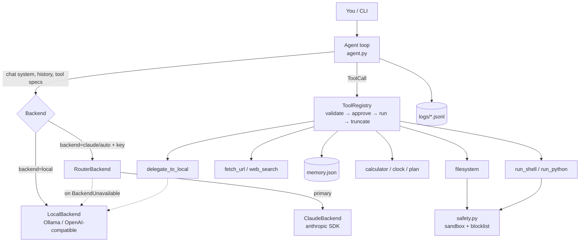
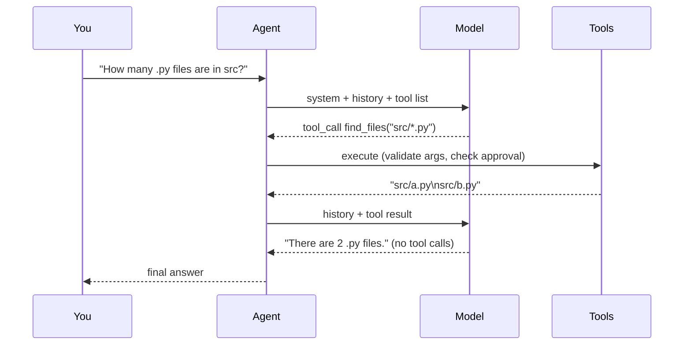

# Architecture

## Components

## One turn, step by step

The loop stops when the model replies **without** tool calls, or after `max_steps`.

## Design decisions

| Decision | Why |
|---|---|
| **Neutral message format** (`messages.py`) with a converter in each backend | One loop, one tool set, any model. Switching models is like swapping power adapters: the device stays the same. |
| **Manual loop rather than the Anthropic SDK's tool runner** | The tool runner only drives Claude. The local model needs the same loop, so the loop lives in our code. |
| **Original Claude content blocks are kept (`Message.raw`)** | The Claude API requires thinking blocks to be sent back unchanged. |
| **Parallel tool results merged into one user message** for Claude | Required by the API. Splitting them teaches Claude to stop making parallel calls. |
| **Errors become `BackendUnavailable`** (network, 401, 429, 5xx) | Gives the router one clear signal for "try the other model". 400 errors are *not* converted, because they mean our request is wrong and falling back would hide the bug. |
| **Server-side refusal fallback on by default** (`CLAUDE_FALLBACKS`) | Recommended for current Claude models. If Claude declines, the API can retry on a fallback model. |
| **Effort `medium`** for `claude-opus-5-5` | That model's API default. Raise `CLAUDE_EFFORT` to `high` for hard agentic work. |
| **Prompt-mode tool calling** for local models | Works with models that have no native tool calling. |
| **Standard library only** for everything local | Nothing to install for key-free mode. `anthropic` is needed only for Claude. |
| **Tool list sorted by name** | The request prefix is byte-identical each turn, which helps Claude's prompt cache. |
| **Tools return error text and never raise** | The model sees the error and can correct itself, and the agent never crashes from a tool bug. |
| **Atomic writes for memory** | A crash can't corrupt `memory.json`. |

## Where the state lives

| State | Location | Lifetime |
|---|---|---|
| Conversation | `Agent.messages` (in RAM) | Until `/reset` or exit |
| Plan / todo list | `ToolContext.state["plan"]` | Until exit |
| Long-term memory | `<workspace>/.agent/memory.json` | Permanent; shared by Claude and the local model |
| Files the agent creates | `<workspace>/` | Permanent |
| Transcript | `logs/session-*.jsonl` | Permanent |

## Extending

- **New tool:** see [TOOLS.md](TOOLS.md#adding-a-tool).
- **New model provider:** subclass `Backend` (`backends/base.py`) and implement
  `chat(system, messages, tools) -> LLMResponse`. Raise `BackendUnavailable` for
  "can't serve right now". Add it to `build_backend` in `backends/__init__.py`.
- **Different system prompt:** `Agent(..., system_prompt="...")`.
- **Hooks / UI:** `Agent(..., on_event=fn)` receives `model`, `thought`, `tool_call`,
  `tool_result` and `message` events.
